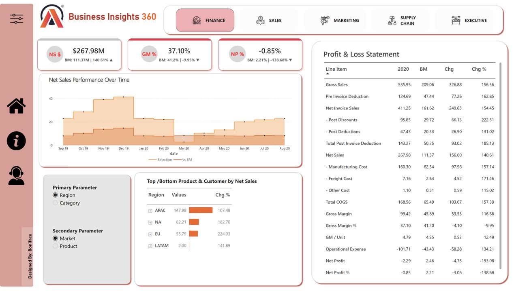

# Power BI Dashboard

## 📌 Problem Statement
**AtliQ Hardware** has expanded across multiple countries, making its operations and analytical needs increasingly complex. Despite its rapid growth, the company still relies heavily on *Excel files* for data analysis and reporting.

The lack of effective business intelligence and timely insights contributed to a significant business loss in Latin America, highlighting the need for a robust and scalable analytics solution.

## 🎯 Project Objective

To empower AtliQ Hardware with a dynamic and integrated business intelligence solution that enhances decision-making across multiple business functions.

This project aims to transition AtliQ from traditional Excel-based analytics to an interactive **Power BI dashboard solution**, enabling stakeholders to monitor performance, identify trends, evaluate profitability, and make informed business decisions.

## 🛠️ Tools & Technologies

- **Power BI Desktop** – Interactive dashboards and visualizations
- **Power Query** – Data cleaning and transformation
- **DAX (Data Analysis Expressions)** – Measures and business calculations
- **Data Modeling** – Relationships and analytical data models
- **Microsoft Excel** – Source data and initial analysis

### 1. 💰 Finance Dashboard

Provides a comprehensive view of the company's financial performance through key financial metrics.

**Key Insights:**
- Profit and Loss (P&L) analysis
- Net Sales performance
- Gross Margin and Gross Margin Percentage
- Net Profit and Net Profit Percentage
- Financial performance trends and comparisons

